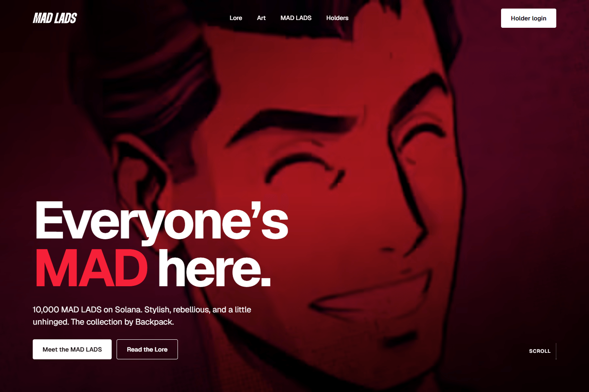
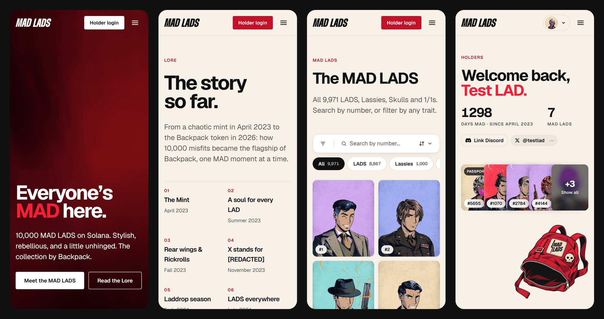
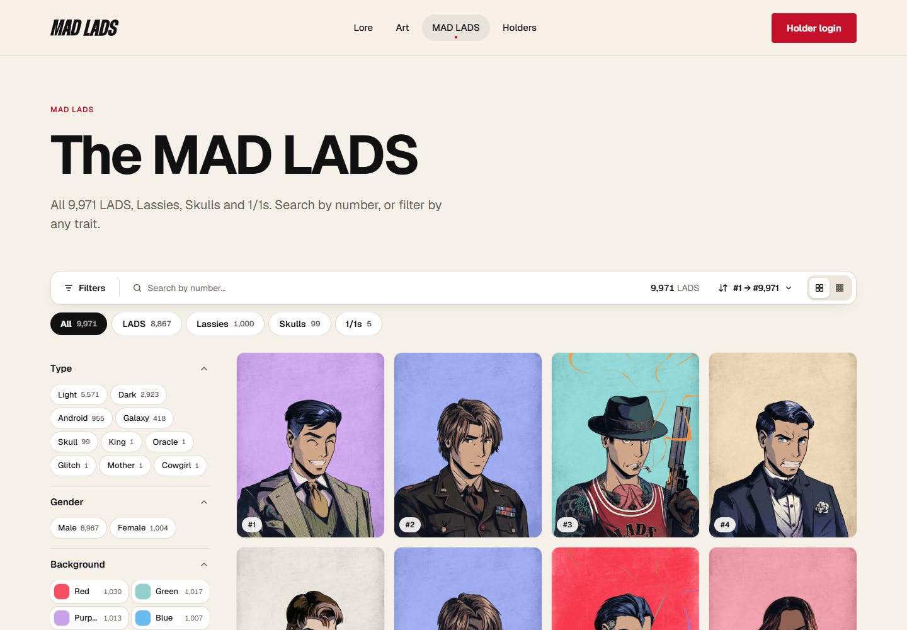
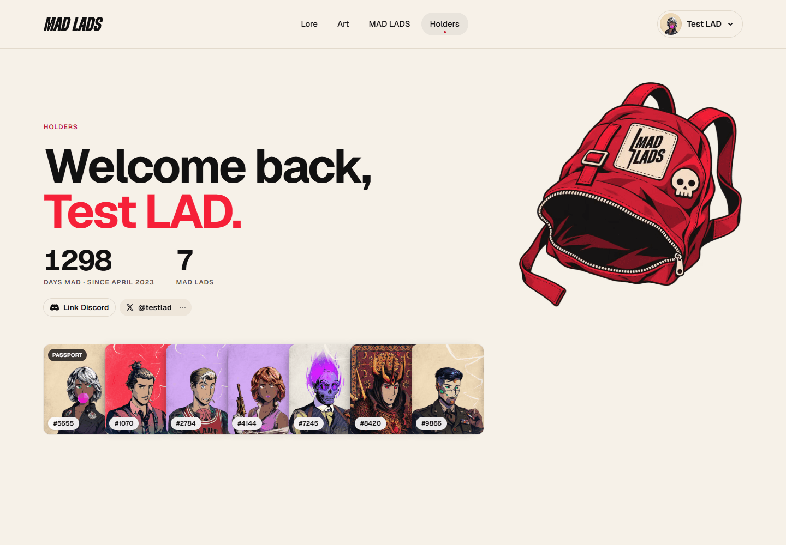

<p align="center">
  
</p>

<h1 align="center">MAD LADS</h1>

<p align="center"><b>The new website for <a href="https://madlads.com">Mad Lads</a>, the Solana collection by Backpack: the Lore, an explorer for all 9,971 Lads, and a holder area you log into with your Backpack wallet.</b></p>

<!-- Live site: add the URL here once madlads.com points to this site. -->

<p align="center">
  
</p>

Browsing needs no wallet and no account. Holders log in with Backpack to open their backpack, passport and wallpapers: signing is free and nothing is ever sent.

## What's inside

| Page | What you see |
| --- | --- |
| **Home** `/` | Hero video, a Mad Lads preview, the manifesto and stats, a marquee of Lads, a Lore teaser, the art (1/1s and specials), the holders section, the latest MAD News, Backpack and the FAQ. The “Bolt strike” intro plays each time the page is opened. |
| **Lore** `/lore` | “The story so far”: nine chapters from the mint (April 2023) to three years MAD, then **Beyond the screen**: real-life photos on a pinned horizontal reel and meetup videos. |
| **Mad Lads** `/madlads` | The explorer: all 9,971 Lads, search by number, 16 trait filters, sort, and a page for every Lad (`/madlads/1234`). |
| **Holders** `/holders` | Log in with Backpack, see your Lads and “Days MAD”, link your X and Discord, and open your backpack: **Passport**, **Wallpapers**, **Dressing room**, **Playlist**, **Memes**, the **Holder map**, plus MAD News, Discord and Games. |
| **Shared passport** `/p/<code>` | The public page behind a passport share link, with its own link-preview card. |
| **Privacy** and **Terms** | `/privacy`, `/terms`. Written for the code as it is: they change when the code does. |

<p align="center">
  
  
</p>

## Features

- **Login with Backpack.** Sign In With Solana, checked on our server. No password and no third-party login. The site only offers Backpack, and disconnects from the wallet as soon as you are logged in.
  - **Ledger.** Tick “I use a Ledger”: you approve a free transaction on the device that is checked and never sent.
  - **Vault wallets.** Lads in a cold wallet or on a Ledger? Sign once with that wallet to link it to your everyday one. From then on, logging in with the everyday wallet counts the vault's Lads too, and gives no access to its funds. Remove a link any time.
- **Link X and Discord.** Small chips on the profile. Your Discord roles on the Mad Lads server become stamps on your passport, and your X handle goes on it too. We keep the account, never the login tokens.
- **The passport.** A shareable card with your photo Lad, handle, “MAD since” date and stamps. The video and image are made in your browser (no upload) and shared through a public link you can switch off.
- **Nothing downloaded in advance.** Lad images are requested by number, only when they appear on screen, and Tensor's image CDN serves a small render that `next/image` shrinks to about 9 KB.
- **An entrance, not just a page.** Almost all motion is pure CSS (scroll-driven animations), off when the visitor asks for reduced motion. See [Motion](#motion).
- **Made to be shared.** One branded 1200×630 link-preview card per page, generated at build time, plus a sitemap, robots.txt and canonical URLs.
- **Accessible and fast.** Lighthouse (mobile, local production build): performance Home 92–100, Lore 95, Mad Lads 87–95. Accessibility, Best practices and SEO are 100.

## Tech stack

- **[Next.js 16](https://nextjs.org)** (App Router) with **React 19** and **TypeScript**. Public pages are static; the holder area is rendered per visitor.
- **[Tailwind CSS 4](https://tailwindcss.com)** with design tokens in `app/globals.css`, **[Geist](https://vercel.com/font)**, and **[Lenis](https://github.com/darkroomengineering/lenis)** for smooth scrolling.
- **[Solana Kit](https://github.com/anza-xyz/kit)** (`@solana/kit` and `@solana/kit-plugin-wallet`, Wallet Standard) for Backpack on the page and for checking signatures on the server.
- **[Helius](https://www.helius.dev)** to read the Lads a wallet holds and since when. **[Neon](https://neon.com)** Postgres for settings, vault links, linked accounts and share links.
- **[mediabunny](https://mediabunny.dev)** to encode the passport video in the browser. **sharp** for images, **puppeteer-core** (dev only) for the README images.

## Project structure

```
app/
├── page.tsx, lore/, madlads/, holders/     the pages (public ones static); holders/map is the holder map
├── p/[code], passport/[token]/             shared passports (database link, or signed link without a database)
├── privacy/, terms/, not-found.tsx         legal pages and the 404
├── api/auth/                               login: wallet/challenge + wallet/verify, login, logout (callback = Matrica)
├── api/accounts/{discord,x}/               link: start, callback, and DELETE to unlink
├── api/holder/                             passport photo, vault wallets, map pin (map/), city search (cities/)
├── api/passport/share                      create or stop a share link
├── layout.tsx, globals.css                 shell and design tokens
components/
├── holder/        profile, the backpack windows, Socials, the holder map (HolderMap, PinDialog), bag.css
├── passport/      the passport, its window, stamps, share view, video export
├── WalletLogin.tsx  "Login with Backpack", the Ledger option, vault links
└── intro/, lore/, beyond/, Nav, Footer…    the rest of the site
lib/
├── auth/          session cookie, wallet login (wallet.ts, solana.ts, siws.ts), Matrica (kept)
├── accounts/      Discord and X linking, and how linked accounts shape the session
├── wallet/        Backpack in the browser (Solana Kit)
├── helius.ts, db.ts, passport-share.ts     blockchain reads, database, share links
├── cities.ts                               city search and check for the holder map (data/cities.json)
└── madlads.ts, news.ts, og.tsx…            collection helpers, MAD News, link previews
data/              editable content: lore, art, news, links, the backpack, memes, dressing room; cities.json (GeoNames, generated)
db/schema.sql      the six tables
public/            lads, art, irl, video, holder objects, collection data (generated)
scripts/           collection data, cities list, database setup, test holders for the map, README screenshots
docs/images/       the images in this README
```

## Getting started

You need **Node.js 20.9 or newer**.

```bash
npm install
npm run dev          # http://localhost:3000
npm run build        # production build
npm start            # serve the production build
npm run typecheck    # next lint no longer exists in Next 16
```

The public pages work with no settings. Everything else is optional and described in [`.env.example`](.env.example). Copy it to `.env.local` for development, and set the same values in Vercel for production.

| To get… | Set |
| --- | --- |
| Login with Backpack | `SESSION_SECRET` (encrypts the login cookie) and `HELIUS_API_KEY` |
| Vault links, X and Discord, share links, “MAD since” saved | `DATABASE_URL`, then `npm run db:setup` once |
| Link Discord | `DISCORD_CLIENT_ID`, `DISCORD_CLIENT_SECRET`, `MADLADS_DISCORD_SERVER_ID`, `MADLADS_STAMP_ROLES` (`role id:Stamp name`, most important first) |
| Link X | `X_API_KEY`, `X_API_SECRET` (keep the app's spend cap at $0: the login is free) |
| Holder map | `DATABASE_URL` and a public Mapbox token in `MAPBOX_TOKEN` (restricted by URL). To try it with made-up holders in development: `npm run db:seed-map -- --yes`, and `-- --remove --yes` to take them off again |
| The login buttons live | `NEXT_PUBLIC_HOLDERS_LIVE=1` (until then they point to the homepage section) |
| Canonical URLs and link previews | `NEXT_PUBLIC_SITE_URL=https://madlads.com` |
| Matrica instead of Backpack | `AUTH_PROVIDER=matrica` plus the `MATRICA_*` settings (kept for later) |
| Test logins in development | `AUTH_MOCK=1`, then `/api/auth/login?as=holder`, `?as=whale` (40 Lads) or `?as=none` |

Register these redirect URLs on the providers: `https://madlads.com/api/accounts/discord/callback` and `…/api/accounts/x/callback` (and the same on `http://localhost:3000` for development).

### Mad Lads data

```bash
npm run data:madlads   # rebuild public/data/madlads.json from the official S3 metadata
```

## Editing content

Most text lives in `data/`, not in the components:

| To change… | Edit |
| --- | --- |
| Lore chapters | `data/lore.ts` |
| 1/1s, honoraries, previews & specials | `data/art.ts` |
| News cards | Automatic: the latest 3 issues of the Mad News Substack (`lib/news.ts`, refreshed every 6 h). `data/news.ts` is the fallback |
| Real-life photos, meetup videos, cities | `data/irl.ts` (photos in `public/irl`) |
| Nav links, socials, marketplaces, press kit | `data/site.ts` |
| What falls out of the backpack | `data/bag.ts` (drop the image in `public/holders/bag/`) |
| Memes, dressing room layers | `data/memes.ts`, `data/dressing-room.ts` |
| Homepage sections, FAQ, stats, manifesto | `app/page.tsx` |

## Design tokens

Defined once in `app/globals.css` (`@theme`), mirroring the [Figma file](https://www.figma.com/design/yJT0LFzcDQkT3OaeJuCl3S/MadLads):

| Token | Value | Use |
| --- | --- | --- |
| `paper` | `#f6f1e8` | Page background |
| `surface` / `sunken` | `#ffffff` / `#ede6da` | Cards, alternate sections |
| `ink` / `muted` | `#111111` / `#5c574f` | Text |
| `red` | `#f62038` | **Brand red**: logo, large display words |
| `accent` | `#c41129` | Accessible red for buttons and small text (WCAG AA) |
| `line` | `#e2dacc` | Borders |

Text styles: `t-display-xl`, `t-display-l`, `t-h2`, `t-h3`, `t-body-l`, `t-eyebrow`.

## Motion

Almost all motion is **pure CSS** ([scroll-driven animations](https://developer.mozilla.org/docs/Web/CSS/CSS_scroll-driven_animations)), defined as utilities in `app/globals.css`. Browsers without support show the content without animation.

| Utility | Effect | Used on |
| --- | --- | --- |
| `reveal` (+ `--i` for stagger) | Fade and rise into view, one after another | Section headers, cards, stats, FAQ |
| `reveal-curtain` + `reveal-zoom` | Image unveils from the bottom and settles from a slight zoom | Art, lore, news images |
| `scroll-words` / `ScrollWords` | A sentence lights up word by word while scrolling | Manifesto |
| `scroll-drift`, `scroll-push`, `scroll-darken` | Hero content drifts up, the background pushes back and darkens | Homepage hero |
| `.reel` | Pinned section, photos glide sideways while scrolling down (desktop); a swipe row on phones | Beyond the screen |
| `bag-*` (`components/holder/bag.css`) | The backpack hops, and each object falls out of it as you scroll | Holder profile |

**Intro (“Bolt strike”, about 1.8 s)** in `components/intro/`: the logo's bolt draws itself, the letters snap in, red flash, curtain up onto the hero. It plays every time the homepage is opened, never for reduced motion, and any click or key skips it. Switch it off with `INTRO_ENABLED` in `components/intro/Intro.tsx`.

## Deploying on Vercel

Import the repository in Vercel, set the values from the table above, and deploy. For a new database, run `npm run db:setup` once with its `DATABASE_URL`. Once madlads.com points to the project, set `NEXT_PUBLIC_SITE_URL=https://madlads.com`: it updates the canonical URLs, `sitemap.xml`, `robots.txt`, the structured data and the link previews.

The launch checklist (domain, emails, legal review, going live) is in [TODO.md](TODO.md).

## README images

The images above are captured from the real site with your installed Chrome. The holder profile needs the development test login, so use the dev server:

```bash
# .env.local: AUTH_MOCK=1
npm run dev                                     # in one terminal
npm run screenshots                             # in another (SITE=… and CHROME_PATH=… to override)
```

Without `AUTH_MOCK`, the holder shots are skipped.

## Notes

- **“MAD since”** is when the wallet got a Lad it still holds, read from the blockchain by Helius, and saved for a week. Lads in linked vault wallets count too.
- **Names.** The profile and the passport show your X handle, otherwise your Discord name, otherwise your shortened wallet address. Share links never show full addresses or linked wallets.
- **Up to 500 Lads** are kept in the login cookie. They are packed (14 bits each, `lib/auth/lads-pack.ts`) so the cookie stays around 2.5 KB, under the browsers' 4 KB limit.
- **Sessions last 8 hours from the wallet signature.** Linking an account or a vault, choosing a photo and unlinking never extend them: only logging in again does.
- **A login proof works once.** Each challenge is also recorded in the database (`used_nonces`), so a copied cookie and signature can't be replayed.
- **Either wallet can end a vault link:** the everyday wallet removes a vault, and the vault, logged in, removes the wallets that can log in for it.
- **If Helius is down at login,** the saved “MAD since” date is kept and tried again next time, instead of being erased.
- **Unlinking X or Discord** also updates the public passport link, so the old handle and stamps leave it.
- **Share links** are public and expire after a year. With a database they are short (`/p/<code>`) and can be switched off; without one they are long signed links.
- **Backpack only is a rule of the page, not of the server.** A signature proves who owns an address, not which wallet app signed it. That is all the holder area needs.
- **The holder map** (`/holders/map`) is for logged-in holders with a Lad, and is optional. A pin is a city centre picked from a GeoNames list (`data/cities.json`, built by `scripts/build-cities.mjs`), never an address, and is **an anonymous dot by default**: the holder turns on “Show my name and Lad” to be shown, and sees the same dot others see. The server sends no name, Lad or date for an anonymous pin. A pin stops showing 12 months after it was last refreshed (`PIN_MONTHS` in `lib/db.ts`): a holder with a Lad opening the map or `/holders` refreshes it (`renewPin`), and a holder with no Lad left still gets a page to remove it. Mapbox only draws the map: the city search never leaves our server, because Mapbox's terms don't let geocoding results be stored. The Mapbox token (`MAPBOX_TOKEN`) is read on the server and only handed to logged-in holders, but it is still visible to them, so restrict it by URL in the Mapbox account.
- **The “On the map” stamp.** A holder with a pin, anonymous or not, gets a blue seal (a globe with a pin) on their passport (`OnTheMap` in `components/passport/Stamps.tsx`). It never says where, because passport links are public. The shared link follows the pin (`updateShareOnMap` in `lib/passport-share.ts`, called by the pin API). With all nine other stamps the stamps page uses a ten-slot layout (`SLOTS_FULL` in `components/passport/Passport.tsx`).
- **The MAD Horoscope** (`/holders/horoscope`, holders only) gives each holder one tarot-style reading per UTC day. The reading (a card, one omen, a “Do”, an “Avoid”, a mood, and now and then a line about the kind of Lad held) is worked out from the login and the date (`lib/horoscope.ts`, words in `data/horoscope.ts`): nothing is stored or sent anywhere, and there is no AI call. The painted source pictures are in `mockup_chatgpt/horoscope` (not in git: keep a copy somewhere safe, the script needs them to rebuild `public/horoscope`). The card's name and the date line follow the curves of the painted banner and ribbon (`components/horoscope/geometry.ts`, measured on the pictures), and the sign's text leans with the easel board. The page is built from painted layers (`public/horoscope`, cut from `mockup_chatgpt/horoscope` by `scripts/build-horoscope-assets.mjs`) with live text on top. **Sound and the entrance:** the sounds are made in the browser with the Web Audio API (`components/horoscope/sound.ts`: no audio files, nothing to license; a switch at the top right turns them off and the choice is kept as `ml_horoscope_sound`). Clicking the crystal ball in the backpack plays a transition (`components/horoscope/enter.ts`, `enter.css`): the ball swells, opens into a swirl of mist that stays until the horoscope page is ready, then thins away and the room settles in. Visitors who ask for reduced motion get a plain link and no animation. The only things remembered are, in the browser, the day a card was drawn (`ml_horoscope`) and the sound choice. The downloadable share card is drawn in the browser on a canvas (`components/horoscope/share-card.ts`).
- **Privacy and Terms** describe exactly what the code stores: update them when you change what is collected. They still need review by Backpack's legal team (see [TODO.md](TODO.md)).

## Credits & rights

Mad Lads artwork, logos and the honorary 1/1s belong to the Mad Lads / Backpack team; usage rights for all content on the site are confirmed by the team. The hero video comes from the [Mad Lads Culture Hub](https://www.madlads-hub.xyz/); event photos from Mad News and meetup videos from the Backpack Exchange YouTube channel; sketches and previews by [@yannpenno](https://x.com/yannpenno). City data for the holder map is from [GeoNames](https://www.geonames.org) (CC BY 4.0); the map is drawn by [Mapbox](https://www.mapbox.com) with © OpenStreetMap contributors data, credited on the map itself.
